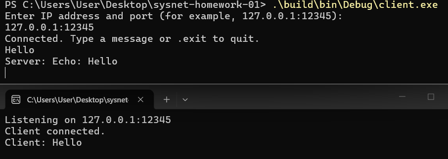

# Сетевое программирование. Сокеты, игра и чат

В проекте три программы с TCP-клиентом и TCP-сервером. Первая проверяет обмен сообщениями, вторая реализует игру для двух игроков, третья принимает сообщения от нескольких участников чата.

## Реализация

| Класс | Назначение |
| --- | --- |
| `TcpSocket` | Оборачивает операции с сокетами Беркли. Дескриптор закрывается автоматически при уничтожении объекта по принципу RAII. |
| `TcpClient` | Подключается к серверу через `Connect` и обменивается данными через `Send` и `Receive`. |
| `TcpServer` | Начинает прослушивание через `Listen`. Метод `Accept` сохраняет соединение внутри сервера, а `AcceptClient` возвращает отдельный объект для каждого подключения. |

`TcpClient` и `TcpServer` приватно наследуют `TcpSocket` и открывают нужные унаследованные методы через `using`. Системные вызовы и типы дескрипторов находятся в реализации `TcpSocket`. Код классов собирается в статическую библиотеку `tcp_socket`.

Данные передаются как `std::string`. Символ новой строки (`\n`) обозначает конец сообщения в TCP-потоке. Принятое соединение имеет собственный сокет, прослушивание продолжается на отдельном сокете.

## Сборка и запуск

Команды выполняются из корня репозитория. Для сборки требуются CMake и компилятор с поддержкой C++20.

### Windows (Visual Studio 2022)

В **Developer PowerShell for VS 2022** выполните:

```powershell
cmake -S homework_01 -B homework_01/build -G "Visual Studio 17 2022" -A x64
cmake --build homework_01/build --config Debug
```

Готовые программы находятся в `homework_01\build\bin\Debug`. Для игры, например, из корня репозитория запустите `.\homework_01\build\bin\Debug\rps_server.exe` и откройте `.\homework_01\build\bin\Debug\rps_client.exe` в двух отдельных терминалах.

### Linux

```bash
cmake -S homework_01 -B homework_01/build
cmake --build homework_01/build
```

Готовые программы находятся в `homework_01/build/bin`.

## Проверка работы

Сначала запустите сервер, затем клиенты в отдельных терминалах.

| Задание | Сервер | Клиент | Адрес |
| --- | --- | --- | --- |
| Обмен сообщениями | `server` | `client` | `127.0.0.1:12345` |
| Камень, ножницы, бумага | `rps_server` | `rps_client` | `127.0.0.1:12346` |
| Чат | `chat_server` | `chat_client` | `127.0.0.1:12347` |

### Обмен сообщениями

Введите в окне клиента `127.0.0.1:12345`, затем `Hello`. Сервер выводит `Client: Hello`, а клиент получает `Server: Echo: Hello`. Для выхода введите `.exit`.



### Камень, ножницы, бумага

Запустите два клиента. Каждый игрок выбирает `1` (камень), `2` (бумага) или `3` (ножницы). Сервер получает оба хода, сравнивает их и отправляет результат каждому игроку. При выборе `1` и `3` первый получит `You win.`, второй — `You lose.`. После раунда сервер ждёт следующую пару.

### Чат

Запустите несколько клиентов и введите в каждом никнейм. Напишите сообщения, например `Hello` от `Alice`. Сервер выведет `Alice: Hello`. Для каждого клиента сервер запускает отдельный поток. Сообщения отображаются в консоли сервера.

Команда `.exit` завершает работу клиента. Чтобы остановить сервер игры или чата, нажмите **Ctrl+C** в его терминале.
